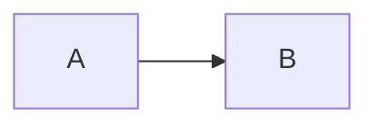

# ypst-template

A Typst 0.15+ template for assignments and technical notes, with bilingual typography, light/dark themes, PDF layouts, and interactive HTML notes.

## Automated builds

Every branch push builds the Linux x86-64 and Windows x86-64 `ypst` executables and updates the existing GitHub release and tag `0.1.0` to that commit. The workflow also supports manual runs. The downloaded executable embeds the template assets but requires the Typst CLI to compile documents. The release also includes `ypst-fonts.tar.xz`, containing the checkout fonts, their licenses, and the original Georgia Core Fonts installer and EULA. On Linux, make the downloaded file executable and rename it to `ypst` if desired.

The `0.1.0` tag is intentionally movable; the workflow needs repository Actions permission to write contents, and tag protection must permit the update. Concurrent runs replace earlier in-progress runs.

## Quick start

Install or update the local package from this repository:

```sh
cargo install --path . --locked
ypst install
```

Run `ypst install` again after rebuilding an updated checkout; it refreshes the existing `0.1.0` installation, including HTML styles and scripts. The command embeds these resources and can be called from any working directory. Existing installed fonts are preserved.

| System | Package destination |
| --- | --- |
| Windows | `%APPDATA%/typst/packages/local/ypst-template/0.1.0/` |
| Linux | `${XDG_DATA_HOME:-$HOME/.local/share}/typst/packages/local/ypst-template/0.1.0/` |
| macOS | `~/Library/Application Support/typst/packages/local/ypst-template/0.1.0/` |

Linux ignores relative `XDG_DATA_HOME` values and uses the default instead.
These are the [standard local package directories](https://github.com/typst/packages#local-packages).
If your compiler or editor overrides `--package-path` / `TYPST_PACKAGE_PATH`,
point it at the corresponding `typst/packages` directory above. Fonts are installed separately.

The package version stays at `0.1.0`. First compilation downloads `headcount:0.1.1` and its dependencies.

```typst
#import "@local/ypst-template:0.1.0": template, front-matter, sidenote
#set document(title: "Technical Notes")
#show: template

#front-matter[
  = Technical Notes
  Author, date, and introductory remarks.
]

= Introduction
#sidenote[Main text.][Additional explanation.]
A statement with a note.#footnote[Supporting details.]
```

```sh
typst compile --font-path ./fonts note.typ note.pdf
cargo install --path . --locked
ypst compile note.typ note.html -- --font-path ./fonts
```

Defaults are `theme: "light"` and `layout: "portrait"`:

```typst
#show: template.with(theme: "dark", layout: "landscape")
```

`--input theme=dark` also sets the PDF theme when no explicit theme is supplied. HTML automatically follows the system light/dark preference, including changes while the page is open. Theme and layout parameters affect PDF only.

## GitHub Actions

The composite action installs Typst `0.15.0`, downloads the `ypst` `0.1.0` release executable, and installs the local template package. It supports Linux and Windows x64 runners and requires GitHub CLI (`gh`), which is preinstalled on GitHub-hosted runners. Check out the article repository first, then compile and deploy it in your own workflow steps:

```yaml
steps:
  - uses: actions/checkout@v4
  - uses: jay-waves/ypst-template@main
  - run: ypst compile article.typ article.pdf
```

Use a branch, tag, or commit SHA in the `uses` reference to select the action
revision. The `ypst` binary is always downloaded from the mutable `0.1.0` release, independently of the selected action revision.

## Features

- `front-matter`: unnumbered headings without a forced page break.
- `sidenote`: text or image notes; use `side-image: path("image.png")` for caller-relative images.
- `definition`, `theorem`, `lemma`, `corollary`, `proof`: environments with English titles. Each statement type has its own counter; proofs are unnumbered and end with a square. Use `#theorem([Name])[Body] <label>` for a named statement or `numbering: none` to omit its number without advancing the counter. PDF block styling options can be passed to the statement; HTML uses dedicated CSS classes. These are template helpers, not the full ctheorems API (`qedhere` and custom counter inheritance are not provided).
- Native equation, figure, and table references. Equations, figures, tables, and statement environments use chapter-prefixed numbering in PDF and HTML; counters restart at numbered top-level headings.

PDF uses native footnotes. In HTML, footnotes expand when clicked and headings
are collapsible. Inline equations use MathML; display equations use SVG and
are not selectable as math. PDF and HTML layouts may differ.

`ypst` preprocesses direct `#chartist` and `#mermaid` calls into static SVG images for both PDF and HTML:

````typst
#chartist("chart.js", width: 75%, caption: [Values])

#mermaid(width: 75%, caption: [Workflow])[

]
````

`#chartist` takes a literal path relative to the source file. The JS file must be inside `--root`, import only `chartist` and `chartist/server`, and synchronously render an SVG in its default export; see `examples/chart.js`. `#mermaid` accepts a raw code block or literal string. Both arguments are optional; `caption` uses Typst content and `width` accepts Typst lengths. These are preprocessing directives available through `ypst`, not ordinary Typst functions; preprocessing currently covers the main input file. Output is static and does not run `hydrate`. Pele supports a subset of Mermaid syntax.

Chartist defaults are defined in `chartist.css` and applied to generated SVG, including PDF and site images. Chartist does not create axis titles automatically; custom titles can use `ct-axis-title-x` (horizontal) and `ct-axis-title-y` (vertical). Tick labels remain horizontal.

The bundled QuickJS graph resources are checked in. To rebuild them after changing their source or dependencies, run `npm ci` and `npm run build:graphs` in this repository.

### HTML export

Build the Rust wrapper once (requires Rust and a C compiler), install Typst CLI, then compile a standalone HTML file:

```sh
cargo install --path . --locked
ypst compile note.typ                 # writes note.html
ypst compile note.typ output.html     # choose an output file
```

The output embeds the theme, scripts, and images. Literal HTTP(S) URLs are supported in `#image("https://example.com/image.png")`: `ypst` downloads them before compilation, with a 15-second timeout and 10 MiB response limit. The same URL is fetched once per compilation; later compilations fetch it again. PDF uses the downloaded file and standalone HTML embeds the image. Supported downloads are PNG, JPEG, GIF, WebP, SVG, and PDF images. Like the graph directives, URL preprocessing currently covers the main input file. The Rust wrapper currently does not perform the legacy equation SVG optimization or document-setting precheck. Place `#set document(...)`
before `#show: template`. Pass Typst options after `--`, for example
`-- --root . --diagnostic-format human`. Site mode uses a temporary entry. Short-format diagnostics (the default) map its source locations back to the original file; human-format diagnostics retain Typst’s temporary entry locations.

For a site with shared CSS and scripts, use:

```sh
ypst compile --root . note.typ --site-root _site
```

This writes `_site/note/index.html` and shared assets under
`_site/_shared/typst/<content-hash>/`. Source paths relative to `--root` (the current directory by default) are preserved; an explicit output selects the page's bundle directory.
Site output extracts embedded PNG, JPEG, GIF, WebP, and SVG images into `_site/_shared/typst/images/` using content hashes; pages use relative URLs and identical images are reused. This includes generated graphs, downloaded images, and ordinary Typst images. Standalone output keeps them embedded. Deploy the site directory together. `--assets-url /static/` replaces the relative
shared-asset URL prefix; map that URL to the generated content-hash directory.
Links are emitted as written, so use paths relative to the output page, such as
`../b/` from `a/index.html` to `b/index.html`. Links to `.typ` files are not
converted to site URLs.

For PDF use `ypst compile note.typ note.pdf` or pass `-- --format pdf`. Other Typst subcommands are passed through. The command returns exit code 0 on success and 1 on failure, including argument and Typst errors.

Source-line anchor injection is temporarily disabled. The wrapper creates a
temporary entry beside the source, so the source directory must be writable;
its filename may also affect code that depends on the source filename.

## Recommended packages

| Package | Use with this template |
| --- | --- |
| [Physica](https://typst.app/universe/package/physica/) | Derivatives, vector calculus, and other scientific notation. Import as a module to avoid name collisions; see `examples/scientific.typ`. |
| [CeTZ](https://typst.app/universe/package/cetz/) | Custom vector drawings. For HTML, render the canvas through `html.frame`; see `examples/scientific.typ`. |
| [headcount](https://typst.app/universe/package/headcount/) | Chapter-dependent native counters. Integrated into equations, figures, tables, and the template’s small theorem environment layer. |

The examples exercise selected package features in PDF and HTML; this is not a guarantee for every package API. Additional packages are downloaded when their examples are first compiled.

## Examples

- [typography.typ](examples/typography.typ): bilingual text, emphasis, heading levels, tables, and code.
- [components.typ](examples/components.typ): front matter, footnotes, text/image sidenotes, theorem environments, cross-references and figures.
- [scientific.typ](examples/scientific.typ): Physica notation and a CeTZ drawing shared between PDF and HTML.

Run from the repository root (replace `components` with another example name):

```sh
typst compile --root . --font-path ./fonts examples/components.typ components.pdf
ypst compile examples/components.typ components.html -- --root .
typst compile --root . --font-path ./fonts --input theme=dark --input layout=landscape examples/components.typ components-dark.pdf
```

Examples import the checkout directly. In your own documents, use `@local/ypst-template:0.1.0` after running the installer.

## Fonts and CSS

| Content | Preferred font |
| --- | --- |
| Latin prose | Georgia |
| Chinese prose | Source Han Serif |
| Headings | Georgia / Source Han Serif |
| Code | Iosevka |
| Math | New Computer Modern Math |

The installer does not install fonts. Download `ypst-fonts.tar.xz` from the `0.1.0` release and extract it, or use the checkout fonts; pass the resulting font directory with `--font-path` for PDF. The archive includes Georgia as the original `georgi32.exe` installer with its EULA, not as extracted font files. Review its terms before use or redistribution. To extract Georgia from the release archive without downloading it again, run `python fonts/download-georgia.py --archive <extracted-dir>/Georgia/georgi32.exe --license <extracted-dir>/Georgia/EULA.html --destination <extracted-dir>/Georgia/extracted`. Linux extraction requires `cabextract` or 7-Zip. The release also provides `ypst-fonts.tar.xz.sha256` for integrity checking.

HTML uses locally installed fonts and falls back to system fonts when they are unavailable. Install the preferred fonts locally to use them; the stylesheet does not load font files.

The `[tool.ypst-template.assets]` tables in `typst.toml` record bundled asset
versions, files, sources and licenses. They are an inventory of this checkout,
not an automatic installer or updater; fonts remain separately installed. The
font version strings come from the files' embedded metadata. Python dependencies
for the optional HTML wrapper are pinned separately in `requirements.txt`.

The stylesheet targets standalone HTML; editor preview support is best-effort. See [HTML stylesheet notes](html/COMPATIBILITY.md).

## Native local preview

```sh
ypst serve note.typ --root .
ypst serve --site-root _site --port 8765
ypst stop
```

`serve INPUT` compiles once into `<system temp>/lib-comrak-preview/<project>/typ` and prints only its preview URL to stdout on success. Compiler errors go to stderr, with short diagnostics mapped to the original source. It starts or reuses the native service on `127.0.0.1:8765`, shared with `comrak2`; both tools can stop that service. The browser reloads when the generated HTML changes. `serve` hosts an existing directory in the foreground. A service hosting another directory on the same port is not reused.

This follows tmcompiler's stream convention. The server uses HTTP revision polling rather than tmcompiler's SSE. Typst's human-format diagnostics are passed through and do not have temporary paths remapped.
